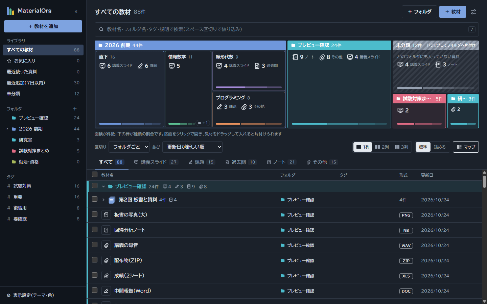
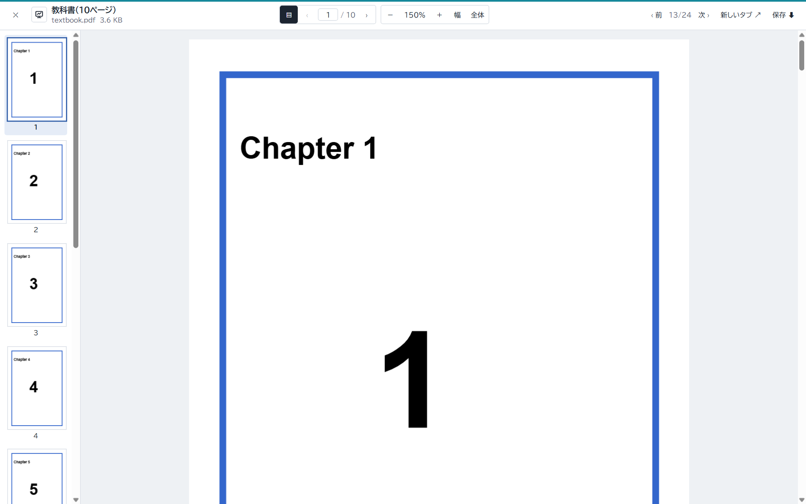

# MaterialOrg（Material Organization）

大学の講義資料（スライド・課題・過去問・ノートなど）を、フォルダとタグで整理して、すぐに見つけて開けるようにする Web アプリです。
PDF・画像・動画・コード・Office ファイルなど形式がばらばらな資料を1か所にまとめ、ページを離れずに中身を確認できます。



## 主な機能

| 分類 | できること |
|---|---|
| 登録 | ファイルのドラッグ＆ドロップで登録（複数ファイルもまとめて）。種類・タグ・説明を付けられる。1ファイル 500MB まで |
| 整理 | フォルダは5階層まで作れる。色分け、ドラッグでの並び替え・入れ子、名前の変更（ダブルクリック・F2・右クリック） |
| まとめ | 教材どうしを重ねると「まとめ」になり、中の並び順をドラッグで変えられる |
| 資料マップ | 面積で件数を表す地図。main → sub の2階層を入れ子で描き、種類はアイコンと割合の棒で示す。区画へドラッグして片付けられる |
| 探す | タイトル・フォルダ名・タグ・説明の検索、直近8件の検索履歴、種類タブ、タグでの絞り込み |
| 見る | マウスを乗せるとプレビュー（PDF のスライドショー、動画の無音再生、コードの自動スクロール）。画面全体のビューアで PDF・画像の拡大と移動、コード検索、Office・CSV・ZIP の中身表示 |
| すぐ戻る | お気に入り、最近使った資料、サイドバーの展開で教材名を表示 |
| ログイン | メールアドレスとパスワードで新規登録・ログイン。数人が使えて、データは本人だけが見られる（共有しない）。パスワードの変更、メールでの再設定 |
| ゴミ箱 | 削除した教材は30日間ゴミ箱に残り、元のフォルダへ戻せる（削除直後の通知の「元に戻す」、Delete キー、サイドバーへのドラッグにも対応）。30日を過ぎると自動で完全に削除 |
| 表示 | 1〜3列の一覧、詰めた表示、ダーク表示、サイドバーのアイコン表示 |



## 技術構成

| 層 | 使っているもの |
|---|---|
| フロントエンド | Next.js 16（App Router）、React 19、TypeScript、Tailwind CSS v4、pdf.js |
| バックエンド | Ruby 4.0 / Ruby on Rails 8.1（API モード）、Puma |
| データベース | PostgreSQL |
| ファイル保存 | Active Storage（開発はローカルディスク、本番は Amazon S3） |
| 品質 | Minitest、RuboCop、Brakeman、ESLint、TypeScript、GitHub Actions |

ブラウザは Next.js にだけアクセスします。`/api/*` と `/rails/active_storage/*` は Next.js の rewrites で Rails に転送するため、CORS の設定は不要です。
詳しくは [システム構成](docs/architecture.md) を見てください。

## ディレクトリ構成

```
MateOrg/
├── backend/                 Rails API
│   ├── app/controllers/api/v1/   materials・folders・bundles・tags
│   ├── app/models/               Material・Folder・Bundle・Tag・MaterialTag
│   ├── db/                       マイグレーションと schema.rb
│   └── test/                     モデル・コントローラーのテスト
├── frontend/                Next.js
│   └── src/
│       ├── app/                  ページとレイアウト
│       ├── components/           layout・materials・preview・viewer・ui など
│       ├── hooks/                データ取得と設定の保存
│       ├── lib/                  API 呼び出し・並び替え・ZIP/Office の読み取りなど
│       └── types/                型定義
├── docs/                    設計書（要件・構成・ER図・API・画面・テスト手順・本番の手順）
└── .github/workflows/ci.yml GitHub Actions
```

## 起動方法（開発環境）

### 必要なもの

- Ruby 4.0.7（`backend/.ruby-version`）と Bundler
- Node.js 24 以上と npm
- PostgreSQL 16 以上（ローカルで起動しておく）

### 1. バックエンド（Rails API、ポート 3000）

```bash
cd backend
bundle install

# PostgreSQL の postgres ユーザーのパスワードを渡す
export POSTGRES_PASSWORD=（ローカルの postgres のパスワード）

bin/rails db:prepare          # DB の作成とマイグレーション
bin/rails server              # http://localhost:3000
```

初めて開いたら画面の「新規登録」でアカウントを作ります。ログイン機能より前に登録していた教材があれば、次のコマンドで自分のアカウントに割り当てます。

```bash
bin/rails users:claim_orphans EMAIL=you@example.com
```

開発ではメールは送られません。パスワード再設定のリンクは Rails のログに `[PasswordsMailer] 再設定のリンク` として出ます。

### 2. フロントエンド（Next.js、ポート 3001）

```bash
cd frontend
npm install

# Rails の場所は RAILS_API_URL で指定する（既定は http://localhost:3000）
npm run dev -- -p 3001
```

ブラウザで http://localhost:3001 を開きます。Rails を別の場所で動かすときは `RAILS_API_URL=http://localhost:4000 npm run dev -- -p 3001` のように指定します（PowerShell では `$env:RAILS_API_URL="..."` を先に実行）。

### 環境変数

| 変数 | 使う場所 | 説明 |
|---|---|---|
| `RAILS_API_URL` | frontend | 転送先の Rails の URL（ビルド時に読み込まれる） |
| `POSTGRES_PASSWORD` | backend（開発・テスト） | ローカルの PostgreSQL のパスワード |
| `RAILS_MASTER_KEY` | backend（本番） | `config/credentials.yml.enc` を開く鍵。リポジトリには入れない |
| `DATABASE_URL` | backend（本番） | 本番 DB（Neon）の接続先。cache・queue・cable の DB は DB 名に `_cache` などを付けて自動で決まる |
| `AWS_ACCESS_KEY_ID`・`AWS_SECRET_ACCESS_KEY`・`S3_BUCKET`・`AWS_REGION` | backend（本番） | 添付ファイルの保存先（Amazon S3） |
| `APP_HOST` | backend（本番） | 受け付けるホスト名（カンマ区切り） |
| `SOLID_QUEUE_IN_PUMA` | backend（本番） | `true` でジョブ（添付の削除・ゴミ箱の自動削除・メール）を Puma の中で動かす |
| `MAX_USERS` | backend | 新規登録できる人数の上限（既定 10） |
| `APP_URL` | backend（本番） | 画面の URL（パスワード再設定のメールのリンクに使う。例 `https://…vercel.app`） |
| `BREVO_API_KEY`・`MAIL_FROM` | backend（本番） | パスワード再設定のメールを Brevo で送るための API キーと、確認済みの送信元アドレス |

本番環境の作り方は [本番環境への移行手順](docs/deployment.md)（Vercel ＋ Render の Web Service（無料）＋ Neon ＋ S3）を見てください。

## テスト

```bash
# バックエンド
cd backend
bin/rails db:test:prepare test
bin/rubocop
bin/brakeman --no-pager

# フロントエンド
cd frontend
npm run lint
npm run typecheck
npm run build
```

主要機能の手動確認の手順は [テスト手順](docs/testing.md) にまとめています。
プッシュとプルリクエストのたびに、GitHub Actions が上のチェックを自動で実行します。

## ドキュメント

| 資料 | 内容 |
|---|---|
| [要件定義](docs/requirement.md) | 目的・想定ユーザー・機能要件 |
| [システム構成](docs/architecture.md) | Next.js・Rails・PostgreSQL・S3 の関係とデータの流れ |
| [ER図](docs/er-diagram.md) / [DB設計](docs/database-design.md) | テーブルと関連 |
| [API仕様書](docs/api-spec.md) | エンドポイント・リクエスト・レスポンス |
| [画面設計](docs/screen-design.md) | 画面の構成と操作 |
| [テスト手順](docs/testing.md) | 自動テストと手動確認 |
| [本番環境への移行手順](docs/deployment.md) | Vercel ＋ Render（無料）＋ Neon ＋ S3 で公開する手順と確認項目 |
| [本番環境ガイド（PDF）](docs/deployment-guide.pdf) | デプロイ先の候補の比較と構築の考え方 |
| [環境構築手順](docs/setup-guide.md) | 初期構築の記録 |
