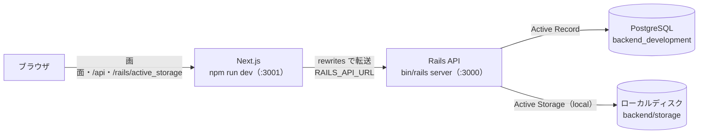
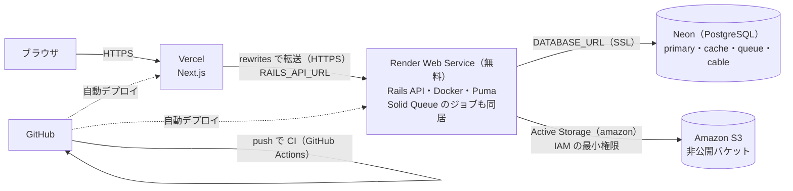
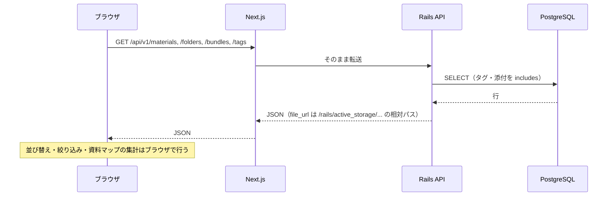

# システム構成設計：Material Organization

## 1. 目的

Material Organization の構成要素、各技術の役割、データの流れを定義する。
本番環境の作り方は [本番環境への移行手順](deployment.md) にまとめている。

## 2. システム構成

ブラウザが直接話す相手は Next.js だけにする。Next.js は画面を返すとともに、`/api/*` と `/rails/active_storage/*` を Rails API へ転送する（`frontend/next.config.ts` の rewrites）。
ブラウザから見ると画面と API が同じオリジンになるため、CORS・Cookie の設定が要らない。

### 2.1 開発環境

### 2.2 本番環境

## 3. 各技術の役割

| 要素 | 役割 |
|---|---|
| Next.js 16（App Router）・React 19・TypeScript | 画面の表示と操作。教材一覧・資料マップ・ビューアなどはクライアント側で描画する。rewrites で Rails への入口を1つにまとめる |
| Tailwind CSS v4 | 見た目。ライト／ダーク、フォルダの色はデザイントークン（CSS 変数）で管理する |
| pdf.js・独自の ZIP 読み取り | PDF のプレビューとビューア、Office（docx/pptx/xlsx）・ZIP の中身表示をブラウザ内で行う |
| Ruby on Rails 8.1（API モード） | 入力の検証、教材・フォルダ・まとめ・タグの登録・取得・更新・削除、ファイルの受け取りと配信 |
| PostgreSQL | 教材・フォルダ・まとめ・タグと、その関連を保存する。本番では Rails 8 の Solid Cache・Solid Queue・Solid Cable 用の DB も使う |
| Active Storage | 教材とファイルを関連付ける。保存先を環境で切り替える（開発：ディスク、本番：S3） |
| Amazon S3 | 本番のファイル保存先。バケットは公開せず、Rails からだけ読み書きする |
| GitHub・GitHub Actions | ソースと変更履歴の管理。push・プルリクエストごとに静的解析・テスト・ビルドを実行する |

## 4. 通信方式

- ブラウザ ⇄ Next.js ⇄ Rails はすべて HTTP（本番は HTTPS）。
- データの受け渡しは JSON。ファイルのアップロードは `multipart/form-data`。
- API のパスは `/api/v1/...`。仕様は [API仕様書](api-spec.md) を参照。
- 成功・失敗は HTTP ステータスで表し、失敗時は `{ "errors": ["..."] }` を返す。

## 5. データ処理の流れ

### 5.1 一覧の取得

### 5.2 教材の登録

1. 利用者がファイルをドロップし、タイトル・種類・タグを入力する。
2. ブラウザが `POST /api/v1/materials` に `multipart/form-data` で送る（Next.js が Rails へ転送）。
3. Rails がタイトル・種類・タグ・拡張子・サイズ（500MB まで）を検証する。
4. Active Storage がファイルを保存先（開発はディスク、本番は S3）へ書き込み、教材とタグを1つのトランザクションで保存する。
5. 登録した教材の JSON を返し、画面の一覧を更新する。

### 5.3 ログイン

1. 画面を開くと `GET /api/v1/session` でログイン状態を確かめ、ログインしていなければログイン画面を出す（`components/auth/AuthGate.tsx`）。
2. ログイン・新規登録が成功すると、Rails が `sessions` に行を作り、`Set-Cookie: session_id=…`（署名付き・httpOnly）を返す。以降のリクエストにはブラウザが自動で Cookie を付ける。
3. API が 401 を返したら（期限切れなど）、画面はログイン画面へ戻る。
4. パスワードを忘れたときは、再設定のリンク（15分で無効）をメールで送り、`/reset-password` で新しいパスワードを設定する。

### 5.4 デモアカウントの初期化

1. 管理者が GitHub の Actions で「Demo reset」を実行する（確認のため `reset` と入力）。
2. GitHub Actions が、Secrets の `DEMO_ADMIN_TOKEN` を付けて `POST /api/v1/admin/demo_reset` を呼ぶ。
3. Rails がトークンを確かめ、`DemoAccount.reset!` を実行する。安全装置は次の3つ。
   - `demo = true` の利用者でなければ例外にする。
   - 削除はその利用者の `user_id` で絞った範囲だけ。
   - 同じアドレスの個人用のアカウントがあれば中止する。
4. 添付ファイルは S3 の実体ごと消し、`backend/db/demo/` のサンプルデータを登録し直す。
5. ログアウトのたびに自動で初期化することはしない（操作中のデータが急に消えないように）。

### 5.5 削除とゴミ箱

1. 削除するとゴミ箱へ移る（`materials.deleted_at` に日時を入れる）。一覧・件数・一括操作の対象から外れ、まとめからは外れる。
2. 画面の通知の「元に戻す」か、サイドバーの「ゴミ箱」から元に戻せる。
3. ゴミ箱で「完全に削除」したもの、または30日を過ぎたもの（`PurgeTrashJob` が毎日 4:00 に実行）は、教材と添付ファイル（S3 の実体）を削除する。添付の削除は Active Storage がジョブで行う。

### 5.6 ファイルの表示

1. プレビュー・ビューアは `file_url`（`/rails/active_storage/blobs/proxy/...`）を読み込む。
2. Next.js が Rails へ転送し、Rails が保存先からファイルを読み出して返す（proxy 方式）。
3. 動画・音声の位置合わせでは Range リクエストを使い、必要な部分だけを受け取る。

## 6. セキュリティ方針

- 秘密情報（`RAILS_MASTER_KEY`、DB の接続情報、AWS の鍵）はリポジトリに入れず、環境変数かホスティング先のシークレット管理で渡す。
- 入力の検証はすべて Rails 側で行う（フロントエンドの検証は使いやすさのため）。
- 添付ファイルは拡張子の許可リストとサイズ上限で制限する。
- S3 のバケットは「パブリックアクセスをすべてブロック」にし、Rails 用の IAM ユーザー（またはロール）には対象バケットの読み書きだけを許可する。
- 本番は HTTPS のみ（`config.force_ssl`）とし、Rails の `config.hosts` で受け付けるホストを限定する。
- ログインが必要（メールアドレスとパスワード、`has_secure_password`）。ログイン状態は DB の `sessions` と、署名付きの httpOnly Cookie（`SameSite=Lax`・本番は `Secure`）で持つ。画面と API が同じオリジンなので CORS は不要で、`SameSite=Lax` によりほかのサイトからの変更の要求には Cookie が付かない（CSRF 対策）。
- データは利用者ごと。API はすべてログイン中の利用者の範囲から探し、添付ファイルの配信（`/rails/active_storage/…`）も教材の持ち主にだけ許す。
- ログイン・新規登録・パスワード再設定には回数の制限（`rate_limit`）をかける。本番の新規登録は既定で閉じていて、`REGISTRATION_OPEN=true` のときだけ `MAX_USERS` 人まで受け付ける。
- デモアカウントのログイン情報・管理用のトークンは、環境変数（Render）と GitHub Secrets にだけ置き、ソースコードや README には書かない。
- パスワード再設定のメールは Brevo の API（HTTPS）で送る。Render の無料プランは SMTP のポートを使えないため。

## 7. デプロイ方針

- Next.js は Vercel、Rails は Render の無料プランの Docker の Web Service（`backend/Dockerfile`。New → Web Service で作成）、DB は Neon の無料プラン、ファイルは S3 に置く。
- Render の無料プランは15分アクセスがないと休止し、次のアクセスで起動する。休止中はジョブも止まるため、ゴミ箱の期限切れの削除は、ゴミ箱を開いたときにも行う。
- 手順は [本番環境への移行手順](deployment.md) を参照。
