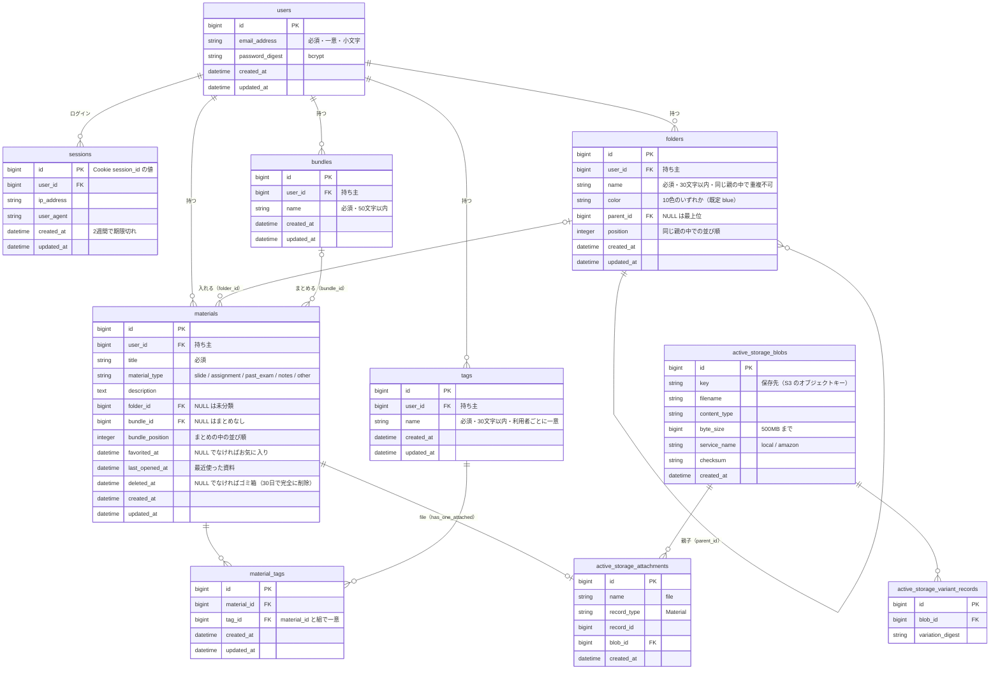

# ER図：Material Organization

`backend/db/schema.rb`（version 2026_10_29_164010）をもとにした、テーブルと関連の図です。
各テーブルの列の意味や制約は [データベース設計](database-design.md) にまとめています。

## 関連の要点

| 関連 | 種類 | 削除したときの扱い |
|---|---|---|
| folders → folders（parent_id） | 自己参照の1対多。最大5階層、循環は検証で防ぐ | フォルダを消すと、中のサブフォルダと教材は1つ上のフォルダ（最上位なら未分類）へ移る（`before_destroy`） |
| folders → materials | 1対多（任意） | 外部キーは `on_delete: :nullify`。教材は消えずに未分類になる |
| bundles → materials | 1対多（任意）。`bundle_position` で並ぶ | まとめを解除しても教材は残る（`dependent: :nullify`）。中身が空になったまとめは自動で消す |
| materials ↔ tags | 多対多（material_tags が中間テーブル） | 教材を消すと material_tags も消える。1教材あたりタグは10個まで |
| materials → ファイル | Active Storage の `has_one_attached :file` | 教材を完全に削除すると添付も消える。実体は開発ではディスク、本番では S3 に置く |
| materials（ゴミ箱） | `deleted_at` による論理削除 | 削除するとまずゴミ箱へ（フォルダは保持、まとめからは外れる）。30日後に `PurgeTrashJob` が完全に削除する |

## 設計上の判断

- **データは利用者ごと**：教材・フォルダ・まとめ・タグに `user_id` を持たせ、API はすべて `Current.user` の範囲から探す。タグ名・フォルダ名の重複も利用者ごとに判定する（`(user_id, name)`・`(user_id, parent_id, name)` の一意インデックス）。添付ファイルの配信も、教材の持ち主にだけ許す。

- **科目テーブルを持たない**：初期設計の `subjects` は廃止し、科目はフォルダで表す（`20261024131329_remove_subject_from_materials`）。科目・学期・単元のような入れ子を、利用者が自由に作れるようにするため。
- **お気に入り・最近使ったは日時の列**：真偽値ではなく `favorited_at`・`last_opened_at` にして、「入れた順」「開いた順」に並べられるようにした。更新は `update_all`・`update_columns` で行い、`updated_at`（更新日順の並び替え）を変えない。
- **ゴミ箱は論理削除**：削除をすぐに確定させず `deleted_at` を入れるだけにして、誤って消した教材を30日間は戻せるようにした。添付ファイルの実体も30日間は残るため、S3 の容量は完全に削除するまで減らない。
- **フォルダ名の重複**：`(parent_id, name)` の一意インデックスに `NULLS NOT DISTINCT` を付け、最上位（parent_id が NULL）どうしでも同じ名前を作れないようにしている。
